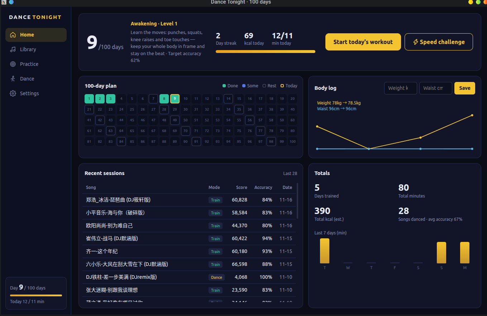

# Dance Tonight · 100-Tage-Bauchmuskel-Fettverbrennungsplan (Desktop)

[](https://github.com/aicccode/dance-tonight/actions/workflows/ci.yml) [](https://github.com/aicccode/dance-tonight/releases/latest) [](https://github.com/aicccode/dance-tonight/blob/main/LICENSE) [](https://github.com/aicccode/dance-tonight/releases/latest)

Ein Fitness-Spiel, bei dem man sich zur Musik bewegt, und zugleich ein 3D-Tanz-Lernwerkzeug. Fitnessübungen werden per Kamera daraufhin bewertet, wie sauber sie ausgeführt werden, und nach Genauigkeit und Rhythmus benotet; bei komplexen Tänzen steht das Abschauen vom Coach, das Lernen der Schritte und das Durchlaufen der Choreografie im Vordergrund. Der VRM-Coach auf dem Bildschirm zeigt die Bewegungen fortlaufend vor und kündigt per Sprachausgabe die nächste Übung an.

Unterstützt Windows, macOS und Linux. Läuft komplett lokal, benötigt keinen Server – die Kamerabilder verlassen deinen Rechner nicht.

|  |  |
|---|---|
| Tanzmodus: Eine importierte Motion-Capture-Sequenz nachtanzen | Heutiges Training: 100-Tage-Plan, Körperdaten und Statistiken |

## Funktionen

| Modus | Beschreibung |
|---|---|
| **Heutiges Training** | Wählt automatisch passend zum 100-Tage-Plan Songs aus, bis die Tagesdauer erreicht ist. Dichte und Vielfalt der Übungen steigen mit den Tagen schrittweise, jeder 7. Tag ist ein Regenerationstag |
| **Sprint-Challenge** | Für schnelle Songs ab 125 BPM (DJ u. a.). Eine Übung pro Takt, Bewertung über eine Lebensleiste: PERFECT +3, GREAT +1, GOOD −4, MISS −14; ist die Leiste leer, ist die Challenge verloren. Beschleunigung im Zeitverlauf zuschaltbar; jeder Song hat eine eigene Bestenliste |
| **Übungsschule** | Eine Übung pro Einheit üben. Der Coach führt im Loop vor, mit Echtzeit-Balken für die Übereinstimmung und Wiederholungszähler auf dem Bildschirm |
| **Modern Dance zum Mitlernen** | 3D-Coach, gesteuert per echtem Motion Capture: Mixamo-FBX-/BVH-/VRMA-Capture-Dateien importieren und nachahmen. 0,25–1-fache Geschwindigkeit, Loop über Abschnitte, Spiegelung, 360°-Drehung per Ziehen, Kameravergleich im Nebeneinander |
| **Tanzmodus** | 27 Tanzbewegungen/Links-rechts-Varianten, vier Choreografien (Starlight Groove / Block Shuffle / Glow Flow / Rotating Stage) mit je 4 Acht-Spuren-Abschnitten. Zuerst langsam und abschnittsweise üben, dann mit Song die komplette Vorführung; komplexe Bewegungen werden schrittweise nach Fertigstellung gelehrt und sind nicht an die 2D-Dreherkennung gebunden |

- **Kalorienschätzung**: Berechnung nach „tatsächlich getroffene Bewegungen × Bewegungs-MET × Dauer pro Takt × Körpergewicht + Grundumsatz“ – ausgelassene Bewegungen zählen keine Kalorien, deutlich nachvollziehbarer als ein fester Faktor mal die Gesamtdauer des Songs. Die MET-Tabelle liegt in `web/js/core/moves.js` (`MOVE_MET`) und `web/js/dance/dancemoves.js` (`DANCE_MET`).
- **Bauchmuskeln und Körperfett**: Ob man Bauchmuskeln sieht, hängt vom Körperfettanteil ab – Bauchtraining allein baut kein Bauchfett ab. Bei konsequentem Training plus Taillenumfang-Messung ist ein Taille/Größe-Verhältnis unter 0,5 ein verlässlicherer Fortschritt als das Gewicht (das Trenddiagramm auf der Startseite zeichnet jetzt Gewicht und Taillenumfang gemeinsam).
- **Tanzbewegungen**: Zu den Basisbewegungen gehören Disco, Händeklatschen, Herz zeigen, Vogue, Armwedeln, Hüftschwung, Dab und Bounce; zu den Fortgeschrittenen gehören Body Wave/Roll, Arm-Wave, Chest Pop, Shoulder Roll, Side-Step, Cross-Step, 360°-Drehung nach links/rechts und Back Body Wave. Fortgeschrittene Bewegungen nutzen mehrtaktige Keyframe-Sequenzen, führen wirklich durch Frontal-, Seiten- und Rückenansicht und enthalten Gewichtsverlagerung vor/zurück; beim Üben werden Schritt-für-Schritt-Hinweise und der Fortschritt der Demo angezeigt, eine Erkennung des Rückens durch die Kamera ist nicht nötig.
- **3D-Coach**: Nutzt ein VRM-Avatar und spiegelt die Demonstration (du hebst das linke Bein, sie hebt das rechte – wie im Spiegel) und trifft den Takt exakt. Das Coach-Fenster lässt sich verschieben und skalieren, die Position wird gemerkt. Bei Combos lächelt sie.
- **Sprach-Coach**: Alle 10 Oberflächensprachen bringen integrierte Offline-Sprachpakete mit und sind sofort einsatzbereit:
  - Chinesisch bringt die eingebaute CosyVoice-Stimme "Longhua" (longhua_v3.1) mit; die übrigen 9 Sprachen (Englisch / Spanisch / Russisch / Japanisch / Koreanisch / Französisch / Deutsch / Portugiesisch / Arabisch) werden mit neuronalen Microsoft-Edge-Stimmen erzeugt – eine einheitliche Frauenstimme, klanglich vergleichbar mit dem Chinesischen. Alle Pakete werden mit dem Repository ausgeliefert und sind sofort einsatzbereit;
  - Die Sprachpakete liegen in `assets/tts/`: `longhua_v3.1@zh/` für Chinesisch, `edge@<Sprache>/` für die anderen Sprachen; in den Einstellungen lässt sich das Paket der aktuellen Sprache durch eigene Aufnahmen ersetzen;
  - Countdown „Drei, zwei, eins“ zum Start, zu Beginn jeder Übungsserie eine Ansage wie „Wechselnd Knieheben links/rechts“;
  - Jeder Satz endet vor dem Taktpunkt, während der Ansage wird die Musik automatisch abgedimmt;
  - Unterwegs gibt es Motivation wie „Geschafft die Hälfte“ oder „Combo ohne Unterbrechung“; im Tanzmodus wird jede Bewegung mit ihrem Namen angesagt („Finger zum Himmel links“, „Armwedeln nach links“ …).
- Die Sprüche liegen in `web/js/core/cue_texts.js`; die 9 nicht-chinesischen Pakete lassen sich mit `python3 scripts/gen_voices_edge.py` neu erzeugen (ergänzt automatisch nur fehlende). Eigene Aufnahmen können in den Einstellungen hochgeladen und die Stimme der aktuellen Sprache ersetzt werden.
- **Blind-Modus**: Jede Bewegung wird mit „links“/„rechts“ angesagt, an Taktpunkten gibt es einen Hinweiston. Auch mit Kopfhörern und geschlossenen Augen kann man mitmachen.
- **Taktanalyse**: Eingebaut ist Beat This! (Beat-Erkennungsmodell der ISMIR 2024, int8-quantisiert, 22 MB), läuft in einem Background-Worker, pro Song rund 8 Sekunden. Auf 49 Testsongs:
  - Tempo bei 48 Songs korrekt erkannt (librosa traf nur etwa die Hälfte, langsame Songs wurden oft als doppeltes Tempo erkannt);
  - Übereinstimmung der Taktzeiten mit dem originalen PyTorch-Modell F = 0,995.
  - Schlägt das Laden des Modells fehl, wechselt die App automatisch zum eingebauten Pure-JS-Beat-Algorithmus.

## Bewegungen

**Fitness-Bewegungen** (nach Freischaltstufe):

| Stufe | Bewegung | Haupttraining |
|---|---|---|
| 1 | 🙌 Beide Arme hoch · 👊 Punch links/rechts | Ausdauer, Schultern |
| 1 | 🍑 Kniebeuge | Beine und Gesäß (Tiefe wird am Kniewinkel bewertet) |
| 1 | 🦵 Knieheben links/rechts · 🤸 Zehentouch | Bauchmuskeln, hintere Kette |
| 2 | ⭐ Jumping Jacks | Ausdauer |
| 2 | ✖️ Linkes Knie zum rechten Ellbogen / rechtes Knie zum linken Ellbogen | schräge Bauchmuskeln |
| 2 | 🦵 Seitliches Knieheben links/rechts · 🦶 Vorwärtskick links/rechts | schräge Bauchmuskeln, Gesäß, Rumpfstabilität |
| 3 | 🌙 Seitliche Beuge links/rechts (haltbar) | seitliche Bauchmuskeln |

**Tanzbewegungen** (27 Bewegungen/Links-rechts-Varianten): Disco-Finger zum Himmel, Händeklatschen vor der Brust, Herz mit beiden Händen, Fashion-Pose, Armwedeln links/rechts, Hüftschwung, Dab, Bounce-Groove sowie Body Wave, Body Roll, Arm-Wave links/rechts, Chest Pop, Shoulder Roll, Side-Step links/rechts, Cross-Step links/rechts, Drehung links/rechts und Back Body Wave.

Wer mehr Jazz-/Modern Dance lernen möchte: Auf [Mixamo](https://www.mixamo.com/) nach Jazz / Contemporary / Dance suchen, als Format **FBX Binary** und bei Skin **Without Skin** wählen, dann unter „Tanz → Motion-Capture-Datei importieren“ importieren (dutzende Dateien auf einmal auswählbar, sie werden einzeln konvertiert; defekte Dateien werden separat aufgelistet und behindern die anderen nicht). Beim Import werden Skelette automatisch erkannt (Mixamo, CMU, gängige BVH, VRMA), Achsen und Ausrichtung korrigiert, A/T-Pose-Unterschiede angeglichen, Capture-Jitter geglättet und ruhige Passagen an Anfang und Ende abgeschnitten; die konvertierten Daten liegen unter `dances/` im lokalen Datenverzeichnis.

**Eigene Choreografie**: Unter „Tanz → Meine Choreografien → Neue Choreografie“ Bewegungen aus der Bibliothek rechts in die Sequenz ziehen (zwischen zwei Bewegungen gezogen, wird sie genau dort eingefügt) oder per Klick direkt hinter die ausgewählte Bewegung anhängen; Bewegungen in der Sequenz lassen sich per Ziehen umsortieren, mit Delete löschen und auf einen Klick links/rechts spiegeln. Jede Bewegung belegt Zeit nach ihrer eigenen Länge: normale Bewegungen 1 Takt, Drehungen/Waves je nach ihrer Taktzahl, Motion-Capture (importierte wie eingebaute Modern-Dance-Moves) wird komplett in Originalgeschwindigkeit abgespielt, die nächste Bewegung beginnt direkt am folgenden Takt. Für die Vorführung einen Song wählen und von der ersten bis zur letzten Bewegung tanzen (die Musik blendet dabei aus); die Abschnittsübung teilt die Sequenz automatisch in etwa 8-taktige Abschnitte. Eingebaute Choreografien lassen sich per „Kopieren & Anpassen“ als Ausgangspunkt nutzen. Choreografien werden in `data/data.json` im Datenverzeichnis gespeichert.

**Fortgeschrittene Choreografien**: „Glow Flow“ betont Körperlinien, Arm-Waves und Brust-/Schulter-Isolation; „Rotating Stage“ betont seitliche Schritte, komplette Drehungen und Rücken-Kombinationen. Mehrtaktige Bewegungen werden vollständig über 2 oder 4 Takte demonstriert, kein Wechsel mitten in der Animation.

## Herunterladen und installieren

Ohne Programmieren: Installer für die eigene Plattform unter [Releases](https://github.com/aicccode/dance-tonight/releases/latest) herunterladen. Doppelklick genügt — kein Konto, keine Online-Aktivierung.

| Plattform | Datei | Installation |
|---|---|---|
| Windows 10 / 11 (x64) | `Dance.Tonight.Setup.*.exe` | Ausführen. Beim ersten Start meldet SmartScreen „Unbekannter Herausgeber“ — auf „Weitere Informationen → Trotzdem ausführen“ klicken |
| macOS (Apple Silicon) | `Dance.Tonight-*-arm64.dmg` | Symbol in „Programme“ ziehen; nicht notarisiert, daher beim ersten Mal Rechtsklick → Öffnen |
| macOS (Intel) | `Dance.Tonight-*.dmg` | Wie oben |
| Linux (x64) | `Dance.Tonight-*.AppImage` | `chmod +x` und starten; fehlt FUSE, `libfuse2` installieren |

Die App ist nicht signiert, deshalb warnen Windows und macOS vor einem unbekannten Entwickler. Der komplette Quellcode liegt in diesem Repository — prüfen oder mit dem nächsten Abschnitt selbst bauen.

## Ausführen vom Quellcode (für alle drei Plattformen)

Node.js 20 oder neuer erforderlich.

```bash
npm install      # Abhängigkeiten über npmmirror (siehe .npmrc), nach der Installation werden MediaPipe/three.js/onnxruntime automatisch nach web/vendor kopiert
npm start
```

`web/vendor/` ist ein generiertes Verzeichnis und liegt nicht im Repository: Nach `npm install` baut `scripts/vendor.mjs` es neu auf und kopiert die Browser-Bibliotheken aus `node_modules` sowie das Posenmodell aus `assets/models/`. Beim Installieren wird nichts heruntergeladen.

Im Verzeichnis `assets/` liegen die eingebauten Ressourcen, sie werden beim Packen mitgeliefert. Das Repository enthält nur das **Minimale-Verifizierungs-Paket** (große/private Ressourcen werden nicht eingecheckt):

| Pfad | Inhalt |
|---|---|
| `assets/models/beat_this_final0.int8.onnx` | Beat-Modell (Beat This! int8, MIT, siehe NOTICE) |
| `assets/avatars/RealMaster.vrm` `SportGirl.vrm` | Eingebaute Coach-Avatare (Lizenz je Modell siehe NOTICE) |
| `assets/dances/*.json` | 3 eingebaute Motion-Capture-Tänze |
| `assets/tts/longhua_v3.1@zh/` `edge@<Sprache>/` | Offline-Sprachpakete für alle 10 Sprachen, werden mit dem Repository ausgeliefert; in den Einstellungen durch eigene Aufnahmen ersetzbar |

**Ablauf der minimalen Verifizierung**: `npm install && npm start` → Songbibliothek → Datei hinzufügen → einen eigenen Song wählen → auf Abschluss der Beat-Analyse warten → auf der Startseite das Training starten; oder direkt auf der „Tanz“-Seite den eingebauten Motion-Capture-Tänzen nachmachen.

**Weitere Ressourcen**:
- VRM-Coach-Avatare: Auf [VRoid Hub](https://hub.vroid.com/) einen gewünschten Avatar herunterladen (auf die Lizenzbedingungen jedes Modells achten), dann unter „Einstellungen → Coach-Avatar“ importieren;
- Motion-Capture-Dateien: Auf der „Tanz“-Seite in der App gibt es einen Einstieg zu [Mixamo](https://www.mixamo.com/), Download mit **FBX Binary + Without Skin**, dann einfach als Stapel importieren;
- Songs: selbst importieren, bei identischem Inhalt wird nur eine Kopie gespeichert.

## Datenmigration zwischen Geräten

Die App geht nicht ins Netz und verlangt keine Registrierung, alle Daten liegen lokal. Um die Daten auf ein anderes Gerät zu übertragen, unter „Einstellungen → Daten → Datenpaket exportieren“ eine `.dtx`-Datei erzeugen: Auswahl pro Kategorie (Training / Gewicht und Taille / eigene Choreografien / importierte Motion-Capture-Daten / Song-Kopien / Beat-Analysen / Einstellungen), gzip-Komprimierung, SM9-Verschlüsselung (SM4-Modus). Der Schlüssel wird allein aus der Passphrase abgeleitet (mindestens 8 Zeichen); die Passphrase steht nicht in der Datei und wird nirgendwohin gesendet. Der Import ist inkrementell: Inhalte werden entdoppelt, vorhandene Einträge bleiben, nur Fehlendes kommt hinzu. Pakete älterer Versionen mit „Konto + Passphrase“ lassen sich weiterhin importieren.

## Open-Source-Lizenz

Apache License 2.0 (siehe [LICENSE](../LICENSE)). Die Lizenzen von Drittmodellen und -ressourcen sind in [NOTICE](../NOTICE) einzeln aufgelistet – besonders auf die Lizenzbedingungen der einzelnen VRM-Modelle unter `assets/avatars/` achten und vor öffentlicher Weitergabe oder kommerzieller Nutzung bestätigen.

## Packaging

| Plattform | Befehl | Ergebnis |
|---|---|---|
| Linux | `npm run dist:linux` | `dist/Dance Tonight-x.y.z.AppImage` |
| Windows (auf Windows) | `npm run dist:win` | NSIS-Installer |
| Windows (Cross-Build unter Linux) | `npm run dist:win-cross` | zip-Portable-Version, nach dem Entpacken `Dance Tonight.exe` ausführen |
| macOS (nur auf einem Mac) | `npm run dist:mac` | dmg (arm64 + x64) |

Die macOS-Version ist nicht mit einem Entwicklerzertifikat signiert, sondern nur ad-hoc. Beim ersten Öffnen per Rechtsklick „Öffnen“ wählen; kommt der Hinweis „beschädigt“, `xattr -cr "/Applications/Dance Tonight.app"` ausführen. Außerdem muss die Kameranutzung unter „Systemeinstellungen → Datenschutz & Sicherheit → Kamera“ erlaubt werden.

## Erste Schritte

1. **Songbibliothek → Gesamten Ordner hinzufügen**: Das Musikverzeichnis auswählen, die Beat-Analyse startet im Hintergrund. Die Musik wird eine Kopie ins Datenverzeichnis der App bekommen (bei identischem Inhalt nur eine Kopie), die Originaldateien können danach gelöscht oder verschoben werden. Zuvor importierte Songs werden beim Start automatisch nachkopiert.
2. Beim Umzug von einer älteren Version: Unter **Einstellungen → Daten** gibt es „Alte Daten importieren“ (`legacy.json`: Trainingseinheiten, Gewicht, Startdatum des Plans, Duplikate werden übersprungen) und „Beat-Analyse-Paket importieren“ (`beat_pack.json`: Abgleich über den Inhalts-Fingerabdruck, diese Songs werden nicht neu analysiert).
3. Eigene Stimme gewünscht? Unter **Einstellungen → Sprach-Coach** Aufnahmen hochladen, die nach dem Spruchtext benannt sind – sie ersetzen die Stimme der aktuellen Sprache; das mitgelieferte Paket lässt sich mit einem Klick wiederherstellen.
4. Zuerst in der **Übungsschule** jede Bewegung einmal durchgehen, dann auf der Startseite das Training starten.

Positionierungstipp: 2,5–3 Meter von der Kamera entfernt stehen, ganzer Körper im Bild (einschließlich Knöchel), Licht von vorn. Vor jedem Song aufrecht stehen und mit natürlichen, herabhängenden Armen etwa 1 Sekunde lang die Kalibrierung abschließen.

| Taste | Funktion |
|---|---|
| Leertaste | Kalibrierung überspringen / Pause |
| Esc | Diesen Song beenden |

## Wo werden Daten gespeichert?

| System | Pfad |
|---|---|
| Windows | `%APPDATA%\Dance Tonight\` |
| macOS | `~/Library/Application Support/Dance Tonight/` |
| Linux | `~/.config/Dance Tonight/` |

Im Verzeichnis speichert `data/data.json` Fortschritt, Ergebnisse und Gewicht, `data/analysis/` die Beat-Analysen der einzelnen Songs, `music/` die Kopien der importierten Songs, und `tts/`, `avatars/` und `dances/` die selbst erzeugten Sprachpakete, importierten Avatare und importierten Motion-Capture-Tänze. Nach dem Import können die Originaldateien alle gelöscht werden; für Backup oder Umzug einfach das ganze Verzeichnis kopieren. Beim Löschen eines Songs in der Songbibliothek wird auch seine Kopie unter `music/` entfernt (deine Originaldateien bleiben unberührt).

## Entwicklung

```bash
npm test                          # Unit-Tests und Abdeckung
python3 scripts/gen_voices_edge.py  # optional: die Sprachpakete für die übrigen 9 Sprachen neu erzeugen (pip install edge-tts)
npm run test:coach                # 14 Basis-Tanzbewegungen × 3 VRM, echte Gelenkwerte an den Judge
npm run test:motion               # 13 Fortgeschrittenen-Bewegungen × 5 Phasen × 3 VRM, verifiziert mit Screenshots
npm run test:mocap                # Motion-Capture-Tänze × 3 VRM Render-Check + Lern-UI/Import-Flow
npm run e2e                       # Electron-End-to-End + beide Coach-Regressionen oben
DT_E2E_EXE=dist/linux-unpacked/dance-tonight npm run e2e   # gepacktes Programm testen
node e2e/pose_gallery.mjs         # Gegenüberstellung aller Fitness-/Tanzposen (bei Bewegungsabläufen der Mittelteil)
node e2e/coach_motion.mjs /tmp/dt-motion  # Kontakttabelle der Bewegungen in fünf Phasen
node scripts/eval_beats.mjs <Songverzeichnis> <Referenz.json> beatthis   # Beat-Genauigkeit bewerten
```

Verzeichnisstruktur:

| Verzeichnis | Inhalt |
|---|---|
| `electron/` | Hauptprozess: Fenster, `app://`-Protokoll (Cross-Origin-Isolation, nötig für WASM-Multithreading), IPC-Aufrufe, lokaler JSON-Speicher, Sprachpaket-Verwaltung, VRM-Verwaltung |
| `web/js/core/` | Bewegungskatalog, 100-Tage-Plan, Chart-Generierung, Sprachtexte. Von Hauptprozess und UI gemeinsam genutzt |
| `web/js/analysis/` | Pure-JS-Beat-Algorithmus, Pre-/Postprocessing von Beat This!, Analyse-Worker |
| `web/js/coach/` | 3D-Coach: three.js + three-vrm, plus Posen und Timing-Kurven |
| `web/js/voice/` | Zeitplanung der Sprachhinweise (pure Funktionen) und Wiedergabe über Web Audio |

## Bekannte Einschränkungen

- Die Schwellenwerte der Bewegungserkennung wurden nur auf synthetischen Posen getestet, **noch nicht mit echten Menschen kalibriert**. Wenn eine Bewegung sauber ausgeführt wird aber nie voll bewertet wird, melde dich – oder passe `MATCHERS` in `web/js/judge.js` an.
- Die Erkennung nutzt nur die 2D-Frontalansicht und kann die Vorwärts-/Rückwärtsrichtung des Körpers und Rückenbewegungen schlecht erfassen. Deshalb **wählen die Fitness-Bewegungen weiterhin leicht frontal erkennbare Posen; Drehungen, Rücken- und Tiefenbewegungen kommen nur beim geführten Tanzen zum Einsatz** und verlassen sich nicht auf Gelenk-Matching-Scoring.
- Die Schwellenwerte der Basis-Tanzbewegungen wurden nur auf synthetischen Posen kalibriert; wenn das Scoring bei echtem Tanzen zu lax oder zu streng wirkt, `DANCE_MATCHERS` in `web/js/dance/dancemoves.js` anpassen. Die geführten Fortgeschrittenen-Bewegungen bewerten nach abgeschlossener Übung und behandeln den Wert nicht als Maß für die Genauigkeit echter Tanzhaltungen.
- Die Windows- und macOS-Versionen wurden bisher nur unter Linux gepackt und **noch nie auf echter Hardware getestet**.
