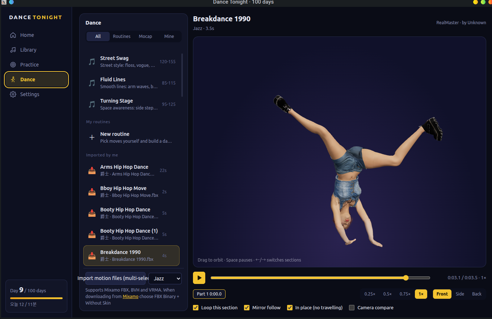

# Dance Tonight · Programme abdos brûle-graisses 100 jours (version desktop)

[](https://github.com/aicccode/dance-tonight/actions/workflows/ci.yml) [](https://github.com/aicccode/dance-tonight/releases/latest) [](https://github.com/aicccode/dance-tonight/blob/main/LICENSE) [](https://github.com/aicccode/dance-tonight/releases/latest)

Un jeu de fitness où l'on bouge en musique, mais aussi un outil d'apprentissage de danse 3D. Les mouvements de fitness sont évalués par la caméra selon la qualité d'exécution et notés sur la précision et le rythme ; pour les danses complexes, l'essentiel est de regarder le coach, d'apprendre les pas et de suivre la chorégraphie jusqu'au bout. Le coach VRM à l'écran enchaîne les démonstrations et la voix annonce à l'avance le mouvement suivant.

Compatible Windows, macOS et Linux. Tout fonctionne en local, sans serveur : les images de la caméra ne quittent jamais votre ordinateur.

|  |  |
|---|---|
| Mode danse : apprendre avec un clip de capture de mouvement importé | Entraînement du jour : plan de 100 jours, mesures corporelles et statistiques |

## Fonctionnalités

| Mode | Description |
|---|---|
| **Séance du jour** | Choisit automatiquement les morceaux selon le programme de 100 jours pour atteindre la durée du jour. La densité et la variété des mouvements augmentent progressivement avec les jours ; tous les 7 jours, c'est un jour de récupération |
| **Défi de vitesse** | Pour les morceaux rapides de 125 BPM et plus (DJ, etc.). Un mouvement par temps, score géré par une barre de vie : PERFECT +3, GREAT +1, GOOD −4, MISS −14 ; barre vide = défi raté. Accélération progressive activable ; classement propre à chaque morceau |
| **Entraînement aux mouvements** | Un seul mouvement à la fois. Le coach montre le geste en boucle, avec barre de correspondance en temps réel et compteur de répétitions à l'écran |
| **Apprentissage de danse contemporaine** | Coach 3D animé par capture de mouvement réelle : importez des fichiers de mocap Mixamo FBX / BVH / VRMA et apprenez en les suivant. Vitesse 0,25 à 1×, boucle par segments, miroir, rotation 360° à la souris, comparaison côte à côte avec la caméra |
| **Mode danse** | 27 mouvements de danse/variantes gauche-droite, quatre chorégraphies (Rythme Starlight / Swing du quartier / Silhouettes fluides / Scène tournante), chacune en 4 sections de 8 temps. D'abord un apprentissage lent section par section, puis une performance complète sur la chanson de votre choix ; les mouvements complexes se travaillent par étapes avec un taux de réussite, sans dépendre des limites de la reconnaissance de rotation en 2D |

- **Estimation des calories** : calculée selon « mouvements réellement réussis × MET du mouvement × durée par temps × poids + métabolisme de base » — les mouvements manqués ne comptent pas, ce qui est bien plus rationnel que de multiplier la durée du morceau par un coefficient fixe. La table des MET se trouve dans `web/js/core/moves.js` (`MOVE_MET`) et `web/js/dance/dancemoves.js` (`DANCE_MET`).
- **Abdos et masse grasse** : si les abdominaux sont visibles dépend du taux de masse grasse ; travailler les abdos ne fait pas maigrir localement. Entraînez-vous régulièrement et notez votre tour de taille : un rapport tour de taille/taille inférieur à 0,5 est un signal de progression plus fiable que le poids (le graphique d'accueil trace désormais à la fois le poids et le tour de taille).
- **Mouvements de danse** : les mouvements de base incluent disco, claquement de mains, cœur avec les mains, pose Vogue, balancement des bras, torsion des hanches, dab et bounce ; les mouvements avancés incluent body wave/roll, arm wave, chest pop, shoulder roll, pas chassé, pas croisés, rotations gauche/droite à 360° et wave de dos. Les mouvements avancés utilisent des keyframes continues sur plusieurs temps, passent réellement de face, de profil et de dos, avec déplacement du centre de gravité avant-arrière ; pendant l'entraînement, des indications étape par étape et la progression de la démo s'affichent, et la caméra n'a pas besoin de reconnaître votre dos.
- **Coach 3D** : utilise un avatar VRM et fait la démonstration en miroir (vous levez la jambe gauche, elle lève la droite, comme devant un miroir), pile sur le temps. La fenêtre du coach peut être déplacée et redimensionnée, la position est mémorisée. Elle sourit pendant les combos.
- **Coach vocal** : les 10 langues de l'interface disposent de packs vocaux hors ligne intégrés, prêts à l'emploi :
  - le chinois embarque la voix CosyVoice intégrée « Longhua » (longhua_v3.1) ; les 9 autres langues (anglais / espagnol / russe / japonais / coréen / français / allemand / portugais / arabe) sont générées avec les voix neuronales Microsoft Edge — une voix féminine unique, d'une qualité comparable au chinois ; tous les packs sont distribués avec le dépôt, prêts à l'emploi ;
  - les packs vocaux se trouvent dans `assets/tts/` : `longhua_v3.1@zh/` pour le chinois, `edge@<langue>/` pour les autres langues ; dans les réglages, le pack de la langue de l'interface peut être remplacé par vos propres enregistrements ;
  - compte à rebours « trois, deux, un » au démarrage, et au début de chaque série une annonce du type « montées de genoux alternées » ;
  - chaque phrase est prononcée avant le temps fort, et la musique baisse automatiquement pendant la voix ;
  - des encouragements en cours de route, comme « déjà à moitié » « combo intact » ; en mode danse, le nom de chaque mouvement est annoncé (« main gauche vers le ciel », « balancer les bras vers la gauche »…).
- Les textes des répliques sont dans `web/js/core/cue_texts.js` ; les 9 packs non chinois se régénèrent avec `python3 scripts/gen_voices_edge.py` (seuls les éléments manquants sont ajoutés). Vous pouvez aussi importer vos propres enregistrements dans les réglages pour remplacer la voix de la langue actuelle.
- **Mode entraînement à l'aveugle** : chaque mouvement est annoncé « gauche » ou « droite », avec un bip sur chaque temps. On peut s'entraîner les yeux fermés, casque sur les oreilles.
- **Analyse rythmique** : Beat This! intégré (modèle de détection de temps d'ISMIR 2024, quantifié int8, 22 Mo), exécuté dans un Worker en arrière-plan, environ 8 secondes par morceau. Sur 49 morceaux de test :
  - tempo correctement identifié sur 48 (librosa n'en réussit qu'environ la moitié et confond souvent les morceaux lents avec le double tempo) ;
  - position des temps : concordance F = 0,995 avec le modèle PyTorch original.
  - En cas d'échec de chargement du modèle, bascule automatique vers l'algorithme de beats en pur JavaScript intégré.

- **Musique en ligne** : cherchez des titres libres de droits depuis la bibliothèque (Openverse, qui agrège Freesound, Jamendo, Wikimedia Commons, etc., sans compte). Seules les licences à usage commercial (CC0 / CC-BY / CC-BY-SA) sont retournées ; écoutez, importez en un clic et l'analyse du rythme démarre toute seule.

## Les mouvements

**Mouvements de fitness** (par niveau de déblocage) :

| Niveau | Mouvement | Zones principalement travaillées |
|---|---|---|
| 1 | 🙌 Mains en l'air · 👊 Coups de poing gauche/droite | Cardio, épaules |
| 1 | 🍑 Squat | Jambes et fessiers (profondeur jugée d'après l'angle du genou) |
| 1 | 🦵 Montées de genoux gauche/droite · 🤸 Toucher des orteils | Abdos, chaîne postérieure |
| 2 | ⭐ Jumping jack | Cardio |
| 2 | ✖️ Genou gauche vers coude droit / genou droit vers coude gauche | Obliques |
| 2 | 🦵 Montées de genoux latérales gauche/droite · 🦶 Coups de pied avant gauche/droite | Obliques, fessiers, stabilité du core |
| 3 | 🌙 Flexions latérales gauche/droite (avec maintien possible) | Flancs |

**Mouvements de danse** (27 mouvements/variantes gauche-droite) : doigt vers le ciel façon disco, claquement de mains devant la poitrine, cœur avec les deux mains, pose fashion, balancement des bras gauche-droite, torsion des hanches, dab, bounce groove, ainsi que body wave, cercle du corps, arm wave gauche-droite, chest pop, cercle des épaules, pas chassés gauche-droite, pas croisés gauche-droite, rotations gauche-droite et wave de dos.

Pour apprendre davantage de jazz/danse contemporaine : cherchez Jazz / Contemporary / Dance sur [Mixamo](https://www.mixamo.com/), choisissez le format **FBX Binary** et Skin **Without Skin**, puis importez via « Danse → Importer des fichiers de mocap » (vous pouvez sélectionner des dizaines de fichiers à la fois ; ils sont convertis un par un, les fichiers corrompus sont listés à part sans affecter les autres). À l'import, le squelette est reconnu automatiquement (Mixamo, CMU, BVH courants, VRMA), les axes et orientations corrigés, les différences de pose A/T alignées, les secousses de capture supprimées et les segments statiques du début et de la fin coupés. Les données converties sont stockées dans `dances/` du répertoire de données local.

**Composer vos propres chorégraphies** : dans « Danse → Mes chorégraphies → Nouvelle chorégraphie », faites glisser les mouvements de la bibliothèque de droite dans la séquence (en les lâchant entre deux mouvements, ils s'insèrent à cet endroit), ou cliquez simplement sur un mouvement pour l'ajouter après celui sélectionné. Dans la séquence, les mouvements peuvent être réordonnés par glisser-déposer, supprimés avec la touche Suppr, ou inversés gauche-droite en un clic. Chaque mouvement occupe le temps de sa propre durée : 1 temps pour un mouvement normal, son nombre de temps pour une rotation/wave, et le mocap (importé comme contemporain intégré) est lu en entier à vitesse originale, le mouvement suivant commençant au temps immédiatement consécutif. Pour la performance, choisissez un morceau et dansez du premier au dernier mouvement (la musique s'estompe en conséquence) ; la pratique par segments découpe automatiquement la séquence en sections d'environ 8 temps. Les chorégraphies intégrées peuvent être « copiées puis modifiées » comme point de départ. Les chorégraphies sont enregistrées dans `data/data.json` du répertoire de données.

**Chorégraphies avancées** : « Silhouettes fluides » met l'accent sur les lignes du corps, l'arm wave et l'isolation poitrine-épaules ; « Scène tournante » sur les pas latéraux, les rotations complètes et les enchaînements de dos. Les mouvements sur plusieurs temps sont démontrés en entier sur 2 ou 4 temps, sans bascule au milieu de l'animation.

## Téléchargement et installation

Pas besoin de coder : téléchargez l'installeur de votre plateforme depuis [Releases](https://github.com/aicccode/dance-tonight/releases/latest). Un double-clic suffit — sans compte, sans activation en ligne.

| Plateforme | Fichier | Installation |
|---|---|---|
| Windows 10 / 11 (x64) | `Dance.Tonight.Setup.*.exe` | Lancez-le. Au premier démarrage, SmartScreen affiche « Éditeur inconnu » : cliquez sur « Informations complémentaires → Exécuter quand même » |
| macOS (puce Apple) | `Dance.Tonight-*-arm64.dmg` | Glissez l'icône dans « Applications » ; l'app n'est pas notariée, donc la première fois : clic droit → Ouvrir |
| macOS (Intel) | `Dance.Tonight-*.dmg` | Idem |
| Linux (x64) | `Dance.Tonight-*.AppImage` | `chmod +x` puis lancez-le ; si FUSE manque, installez `libfuse2` |

L'application n'est pas signée, Windows et macOS signaleront donc un développeur inconnu. Tout le code est dans ce dépôt : vérifiez-le, ou compilez-le avec la section suivante.

## Exécuter depuis les sources (commun aux trois plateformes)

Nécessite Node.js 20 ou supérieur.

```bash
npm install      # dépendances via npmmirror (voir .npmrc), copie automatique de MediaPipe/three.js/onnxruntime dans web/vendor après installation
npm start
```

`web/vendor/` est un dossier généré, non versionné : `scripts/vendor.mjs` le reconstruit après `npm install`, en copiant les bibliothèques navigateur depuis `node_modules` et le modèle de pose depuis `assets/models/`. Aucun téléchargement n'a lieu pendant l'installation.

Le répertoire `assets/` contient les ressources intégrées, incluses lors du packaging. Le dépôt n'embarque que le **paquet de vérification minimal** (les ressources volumineuses/personnelles ne sont pas dans le dépôt) :

| Chemin | Contenu |
|---|---|
| `assets/models/beat_this_final0.int8.onnx` | Modèle de beats (Beat This! int8, MIT, voir NOTICE) |
| `assets/avatars/RealMaster.vrm` `SportGirl.vrm` | Avatars de coach intégrés (licence de chaque modèle : voir NOTICE) |
| `assets/dances/*.json` | 3 danses mocap intégrées |
| `assets/tts/longhua_v3.1@zh/` `edge@<langue>/` | Packs vocaux hors ligne pour les 10 langues, distribués avec le dépôt ; remplaçables par vos propres enregistrements dans les réglages |

**Procédure de vérification minimale** : `npm install && npm start` → bibliothèque de morceaux → ajouter des fichiers → choisir un de vos morceaux → attendre la fin de l'analyse rythmique → lancer la séance depuis l'accueil ; ou aller directement dans « Danse » pour suivre le mocap intégré.

**Ressources supplémentaires** :
- Avatars VRM de coach : téléchargez l'avatar qui vous plaît sur [VRoid Hub](https://hub.vroid.com/) (attention aux conditions de licence de chaque modèle), puis importez-le via « Réglages → Avatar du coach » ;
- Fichiers de mocap : la page « Danse » de l'application donne accès à [Mixamo](https://www.mixamo.com/), téléchargez en **FBX Binary + Without Skin** et importez en lot ;
- Morceaux : importez les vôtres ; un seul exemplaire est conservé pour un contenu identique.

## Migration des données entre appareils

L'application ne se connecte pas à Internet et ne demande aucune inscription ; toutes les données restent en local. Pour transférer les données vers un autre appareil, utilisez « Réglages → Données → Exporter le paquet de données » et générez un fichier `.dtx` : sélection par catégorie (séances / poids et tour de taille / mes chorégraphies / captures de mouvement importées / copies de morceaux / analyse rythmique / réglages), compression gzip, chiffrement SM9 (mode SM4). La clé est dérivée de la seule phrase secrète (8 caractères minimum) ; cette phrase n'est jamais écrite dans le fichier ni transmise. L'import est incrémental : le contenu est dédoublonné, l'existant est conservé et seuls les éléments manquants sont ajoutés. Les paquets exportés par d'anciennes versions avec « compte + phrase secrète » s'importent toujours.

## Licence open source

Apache License 2.0 (voir [LICENSE](../LICENSE)). Les licences des modèles et ressources tiers sont détaillées élément par élément dans [NOTICE](../NOTICE) — prêtez particulièrement attention aux conditions de licence de chaque modèle VRM dans `assets/avatars/` avant toute diffusion publique ou usage commercial.

## Packaging

| Plateforme | Commande | Résultat |
|---|---|---|
| Linux | `npm run dist:linux` | `dist/Dance Tonight-x.y.z.AppImage` |
| Windows (sous Windows) | `npm run dist:win` | Installeur NSIS |
| Windows (cross-build sous Linux) | `npm run dist:win-cross` | Version portable zip ; après extraction, lancez `Dance Tonight.exe` |
| macOS (obligatoirement sur Mac) | `npm run dist:mac` | dmg (arm64 + x64) |

La version macOS n'est pas signée avec un certificat de développeur, seulement en ad-hoc. Au premier lancement, faites un clic droit puis « Ouvrir » ; si le message « endommagé » apparaît, lancez `xattr -cr "/Applications/Dance Tonight.app"`. Il faut aussi autoriser l'accès à la caméra dans « Réglages Système → Confidentialité et sécurité → Caméra ».

## Première utilisation

1. **Bibliothèque de morceaux → Ajouter tout un dossier** : sélectionnez votre répertoire musical, l'analyse rythmique démarre en arrière-plan. Les morceaux sont copiés dans le répertoire de données de l'application (un seul exemplaire pour un contenu identique) ; ensuite vous pouvez supprimer ou déplacer les fichiers originaux. Les morceaux importés auparavant verront leur copie complétée automatiquement au démarrage.
2. Pour migrer depuis une version antérieure : **Réglages → Données** propose « Importer les anciennes données » (`legacy.json` : séances, poids, date de début du plan, doublons écartés) et « Importer le paquet d'analyse rythmique » (`beat_pack.json` : apparié par empreinte du contenu, ces morceaux ne sont pas réanalysés).
3. Envie d'utiliser votre voix ? Dans **Réglages → Coach vocal**, importez des enregistrements nommés d'après le texte des répliques pour remplacer la voix de la langue actuelle, ou restaurez le pack intégré en un clic.
4. Passez d'abord par **Entraînement aux mouvements** pour répéter chaque mouvement, puis revenez à l'accueil pour commencer la séance.

Conseil de placement : à 2,5 à 3 mètres de la caméra, corps entier dans le cadre (chevilles comprises), lumière venant de face. Avant chaque morceau, tenez-vous droit, bras relâchés, environ 1 seconde pour terminer l'étalonnage.

| Touche | Fonction |
|---|---|
| Espace | Passer l'étalonnage / pause |
| Échap | Terminer ce morceau |

## Où sont stockées les données

| Système | Emplacement |
|---|---|
| Windows | `%APPDATA%\Dance Tonight\` |
| macOS | `~/Library/Application Support/Dance Tonight/` |
| Linux | `~/.config/Dance Tonight/` |

Dans ce répertoire, `data/data.json` conserve progression, scores et poids, `data/analysis/` l'analyse rythmique de chaque morceau, `music/` les copies des morceaux importés, et `tts/`, `avatars/` et `dances/` vos voix générées, vos avatars importés et vos danses mocap importées. Après import, les fichiers originaux peuvent tous être supprimés ; pour une sauvegarde ou un changement d'ordinateur, copiez simplement le répertoire entier. Quand vous supprimez un morceau dans la bibliothèque, sa copie dans `music/` est supprimée en même temps (vos fichiers originaux ne sont pas touchés).

## Développement

```bash
npm test                          # tests unitaires et couverture
python3 scripts/gen_voices_edge.py  # facultatif : régénérer les packs vocaux des 9 autres langues (pip install edge-tts)
npm run test:coach                # 14 mouvements de danse de base × 3 VRM, articulations réelles envoyées au juge
npm run test:motion               # 13 mouvements avancés × 5 phases × 3 VRM, validation et captures d'écran
npm run test:mocap                # danses mocap × 3 VRM : vérification du rendu + interface d'apprentissage/import
npm run e2e                       # parcours complet Electron + régressions des deux types de coach ci-dessus
DT_E2E_EXE=dist/linux-unpacked/dance-tonight npm run e2e   # tester le programme packagé
node e2e/pose_gallery.mjs         # planche comparative de toutes les poses fitness/danse (phase médiane pour les mouvements continus)
node e2e/coach_motion.mjs /tmp/dt-motion  # table de contact des mouvements en 5 phases
node scripts/eval_beats.mjs <répertoire de morceaux> <résultats de référence.json> beatthis   # évaluation de la précision rythmique
```

Structure des répertoires :

| Répertoire | Contenu |
|---|---|
| `electron/` | Processus principal : fenêtres, protocole `app://` (isolation cross-origin, requise par le multithreading WASM), appels inter-processus, stockage JSON local, gestion des packs vocaux, gestion VRM |
| `web/js/core/` | Catalogue des mouvements, programme 100 jours, génération des chartes, répliques vocales. Partagés entre le processus principal et l'interface |
| `web/js/analysis/` | Algorithme de beats en pur JS, pré- et post-traitement de Beat This!, Worker d'analyse |
| `web/js/coach/` | Coach 3D : three.js + three-vrm, poses et courbes temporelles |
| `web/js/voice/` | Planification temporelle des annonces vocales (fonctions pures) et lecture Web Audio |

## Limitations connues

- Les seuils de jugement des mouvements n'ont été testés que sur des poses synthétiques, **pas encore calibrés sur de vraies personnes**. Si un mouvement est bien exécuté mais n'obtient jamais le maximum, signalez-le-moi ou ajustez les `MATCHERS` dans `web/js/judge.js`.
- La reconnaissance n'utilise qu'une vue 2D de face et ne distingue pas bien la profondeur du corps ni les mouvements de dos. C'est pourquoi **les mouvements de fitness n'utilisent que des poses faciles à détecter de face ; rotations, poses de dos et mouvements en profondeur sont réservés à l'apprentissage guidé de la danse**, sans dépendre d'un score de correspondance articulaire.
- Les seuils des mouvements de danse de base n'ont été calibrés que sur des poses synthétiques ; si en dansant réellement la notation vous semble trop laxiste ou trop stricte, ajustez les `DANCE_MATCHERS` dans `web/js/dance/dancemoves.js`. Les mouvements avancés guidés se jugent à la complétion du suivi, pas à l'exactitude de la posture sur une vraie personne.
- Les versions Windows et macOS n'ont été packagées que sous Linux et **n'ont pas encore été testées sur machine réelle**.
